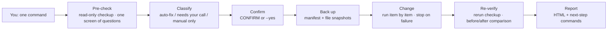

<div align="center">
  <h1>CC tackle</h1>
  <p><strong>Local environment checkup and controlled cleanup for Claude Code</strong></p>
  <p>macOS · Python standard library · Evidence first · Reviewable changes · One command</p>
  <p>
    <a href="LICENSE"></a>
    
    
    
    <a href="https://github.com/VioletScar-Hui/cc-tackle/actions/workflows/tests.yml"></a>
    
  </p>
  <p>
    <a href="#what-it-does">What it does</a> ·
    <a href="#bottom-lines">Ground rules</a> ·
    <a href="#how-it-works">How it works</a> ·
    <a href="#authorization">Tiered authorization</a> ·
    <a href="#quick-start">Quick start</a> ·
    <a href="#detection-scope">Detection scope</a> ·
    <a href="#data-boundaries">Data boundaries</a> ·
    <a href="#docs">Documentation</a>
  </p>
  <p>
    <a href="README.md">中文</a> · English ·
    <a href="CHANGELOG.md">Changelog</a> ·
    <a href="docs/decisions.md">Decision records</a> ·
    <a href="#verified">Verification depth</a>
  </p>
</div>

> This is the English translation of [README.md](README.md). The Chinese version is authoritative.


> **Scope**: This is an environment inspection and maintenance tool for a local macOS machine. It helps you find visible problems in network egress, proxy leftovers, time zones, browser measurements, and local Claude Code configuration; it cannot explain server-side risk controls, and it cannot guarantee that an account is usable or that it will pass any service's review.

CC tackle puts detection, evidence, backup, and re-verification in one command chain. By default it looks at the environment first, then decides whether to act. A plain `--audit` **writes and opens an HTML page by default** (a newcomer cannot tell the next step from the terminal table), but it still does not write audit JSON, egress history, or caches; for scripted use, set `CLAUDE_GUARD_NO_REPORT=1` to turn off the page, and add `--audit --save-audit` if you want to keep JSON. Full hardening first shows the execution checklist, and only after confirmation does it lock the targets, back up, and modify.

It is a set of scripts and also a skill for agents: `SKILL.md` states the criteria and execution boundaries, and the agent follows them; a person can also just type a single command in the terminal.

<a id="what-it-does"></a>

## What it does

| Capability | What it does specifically |
| --- | --- |
| **Network identity** | Checks the egress IP and ASN type, egress changes, DNS leaks, WebRTC, IPv6, and routing results for Claude domains, and separates "not measured" from "anomalous". |
| **Proxy chain** | Looks for leftovers or inconsistencies in the system proxy, shell, npm, git, and proxy software configuration, and keeps raw evidence for review; identifies backends such as mihomo / sing-box / Surge / v2ray. |
| **Claude configuration** | Checks the endpoints, credentials, and proxy variables in `settings.json`, plus telemetry switches, CLI signatures, and traces of third-party clients. |
| **Account environment** | Verifies the time zone hierarchy, browser Intl locale, browser profile reuse, traces of multiple accounts, and keychain entries. |
| **Environment hygiene** | Finds project-level `.claude` noise, invalid permission entries, stale worktree registrations, and reclaimable system space. |
| **Persistent protection** | Can optionally install a direct-connection watchdog (kills processes that bypass the tunnel), egress IP drift alerts, and a residential route lock (pf + DNS guard). |
| **Manual checklist** | For browser permissions, system settings, and external checks that scripts cannot replace, gives sourced paths for manual verification. |

<a id="bottom-lines"></a>

## Ground rules (read these first)

- **You handle money and accounts.** Payments, sign-in, KYC, and OAuth are all done by you personally. The script does not sign in, pay, or file appeals.
- **Do not read credential values.** Long-lived tokens are recorded only as "which file or variable it is written in"; values are never read and never appear in reports.
- **Back up before changes; always re-verify after.** No backup is created and no state is changed before confirmation; stop if a backup fails; read back and assert after each change; actions that cannot be rolled back exactly are listed separately and default to No.
- **Other people's tools are reported, not modified.** Configuration under `~/.codex`, `~/.dsh`, and other software is scanned, but only marked "do not modify on their behalf".
- **Do not draw conclusions for the platform.** No promise of avoiding bans, no explanation of server-side risk controls, and no treating "network reachable" as "account usable"; it reports only the evidence measured on this machine during that run.

<a id="how-it-works"></a>

## How it works



- **Look before touching.** A read-only audit does not write this tool's configuration or state; if changes are actually needed, you get a checklist first, and work starts only after you approve.
- **One run.** The full flow runs in one pass: checkup → fix what can be auto-fixed on the spot → re-check → one HTML report; no separate post-check is needed.
- **The report is evidence, not a manual.** The page lists two sets of real readings, and at the end the agent also states the next-step commands directly in its reply.
- **Agents and humans use the same entry point.** Without a TTY, the same set of authorizations is expressed with flags (such as `--yes`); the script does not relax them just because the caller is an agent.

<a id="authorization"></a>

## Tiered authorization: what needs your approval

| Tier | What you do | What it maps to in this skill |
| --- | --- | --- |
| 🟢 **A · Read-only, run directly** | Just say so | `--audit`, `--json`, `selfcheck --fast`, `proxy_guard.py --check`, `net_guard.py --once --dry-run`, `residential_lock.py --status/--check/--discover`, open the report page |
| 🟡 **B · Approve a plan once** | Approve the whole checklist; it then executes continuously and stops on failure | `--fix-auto --yes` (four kinds of leftovers), full hardening with one `CONFIRM` (each item defaults to No, verify every step), `net_guard.py --install --yes`, `residential_lock.py --init/--install`, `--install-webrtc-limiter` |
| 🔴 **C · Decide when you reach that step** | Confirm on the spot, no advance approval | `sudo` two steps (disable IPv6, disable Location Services "Set time zone"), `residential_lock.py --root-install` (modify `/etc/pf.conf` + install a LaunchDaemon), `--fix-unverified` (change a third-party proxy's DNS), `--restore` (overwrite the current state), cleanup that cannot be rolled back exactly (system caches, old versions) |

Approval is based on your explicit reply in the conversation; if the target or route changes, confirm again. `--yes` only replaces the single confirmation before `--fix-auto` takes action; it does not replace any step in tier C.

<a id="quick-start"></a>

## Quick start

### 1. Run everything with one command (recommended)

One screen of questions → checkup → fix → re-check → one HTML report:

```bash
python3 scripts/account_guard.py --preflight --fix-auto
```

- `--preflight` asks four things before the checkup: whether to open the browser verification page now (Intl and media permissions become conclusive only through it), whether to run a WebRTC probe at the same time, which Chrome profile to open the verification page in (leave blank for the default profile), and whether there is a fixed egress country and IP to declare. Items answered "yes" are measured in this run; items answered "no" remain truthfully at `·`, without pretending to pass.
- `--fix-auto` lists the auto-fixable leftovers on the spot — system proxy leftovers, shell proxy lines, npm / git global proxies, and endpoints and proxy variables in `settings.json` — and after one confirmation it backs up, then changes them; it does not request root and does not delete anything that cannot be rolled back exactly.
- After fixes it re-checks automatically, writes and opens a before/after HTML page. If there is nothing to fix, or you cancel at the confirmation, you still get a page.

When the agent has no real terminal, express the same authorizations with flags and finish in one turn:

```bash
python3 scripts/account_guard.py --audit --verify-browser --webrtc --fix-auto --yes
```

`--yes` is valid only for `--fix-auto`; it is equivalent to the user having agreed to that checklist in the conversation, so you must ask first and only then pass it.

### 2. Just want a read-only look first

```bash
python3 scripts/account_guard.py --audit            # read-only checkup; also produces an HTML report by default
python3 scripts/account_guard.py --audit --save-audit   # also save a JSON copy
python3 scripts/account_guard.py --audit --json         # machine-readable results only
```

A read-only audit still calls `claude` and `npm` to read state, and those two CLIs write things themselves; it does not write audit JSON, egress history, or caches unless you explicitly add `--save-audit`. To disable the automatically opened report page: `CLAUDE_GUARD_NO_REPORT=1`.

If you have an explicit route target, write the target country and egress IP into the audit together:

```bash
python3 scripts/account_guard.py --audit \
  --expected-country US \
  --expected-exit-ip 203.0.113.10
```

Both values must be supplied by you; the script will not infer the target from historical records or current measurements. When no target is specified, it can only report "no target declared".

You can also do it in two steps: first run `--audit --preflight` for a read-only checkup, then run the command with no arguments for the full pipeline (list → CONFIRM → back up → change → re-check → HTML). This path takes two runs because the first step is purely read-only.

### 3. Report page: static HTML and click-to-fix

Full hardening and `--fix-auto` both **generate one** self-contained HTML report at the end, saved to `~/ClaudeGuardBackups/report-<timestamp>.html` — that page is the before/after comparison: the top shows the "before fix → after fix" score, and below it lists the two real readings for each item. The score is **additive**: 27 base items total 100 points (each item is worth 100/27; full marks for a pass, half for pending, 0 for fail), "not measured" also counts as 0, and the denominator is fixed at 27 items; "login method" is row 28 but is not one of the 27 items, and adds 5 points when it passes, so the page maximum is 105.

The page also has a section, "This skill's persistent programs": it lists only background tasks that this skill installed itself, grouped by function (network protection / report service / checkup and cleanup), and marks whether they are running, whether they are set to launch at login, and whether they are disabled. Agents from other software and the system are not included. It is only a list; it does not count toward the score or modify any plist. The entire page references no external resources (no CDN, no web font, no JS); every number on the page comes from the report itself — judgments and terminal output share the same source, `build_summary`.

```bash
python3 scripts/report_html.py --open              # re-render with the latest report
python3 scripts/report_html.py <report.json> --out ~/Desktop
```

To make it **click-to-fix**, use local service mode:

```bash
python3 scripts/report_serve.py
```

After the checkup it starts a service bound only to `127.0.0.1` and opens the page. Auto-fixable items get an extra button on the right; one click executes the fix, the page refreshes, and the top states what was done this time. The top also has "Fix all auto-fixable items" and "Re-run checkup", the footer has "Stop local service", and it exits automatically after 30 minutes idle. Security boundaries: random port, a one-time token in the URL, a required custom header for POST, an action allowlist, and requests without a token always return 404.

Buttons appear only on items the tool would already perform automatically: system proxy leftovers, shell/npm/git proxies, settings.json endpoints and credentials, Clash DNS, browser Intl, system-level reclaimable space, invalid settings permissions, project-level junk, and stale worktree registrations. Items that need human judgment (telemetry switches, IPv6, Location Services) and items that must be handled manually (phone time zone, payment, browser isolation) get no button.

DNS configuration changes for third-party proxies (sing-box / v2ray / Surge) are not among the buttons and are not executed by default: whether a change takes effect depends on that software restarting itself, which the script cannot verify. You must enable them explicitly with `--fix-unverified`, and it backs up first.

### 4. Persistent protection (optional, not installed by default)

A checkup only "looks"; these layers handle "blocking" and "watching". None of them is installed by default; they must be enabled explicitly.

**Direct-connection watchdog**: every 5 seconds it reviews outbound TCP connections of Claude-related processes. If it finds one bypassing the tunnel (the route lands on a physical interface such as `en0`, not `utun`), it SIGKILLs that process and writes the pid, process path, destination address, and egress interface to the log.

```bash
python3 scripts/net_guard.py --once --dry-run   # inspect the criteria first; observe only, do not kill
python3 scripts/net_guard.py                    # run in the foreground, every 5 seconds; kill the process when a direct connection is found
python3 scripts/net_guard.py --install --yes    # install as a persistent LaunchAgent (every 5 seconds)
python3 scripts/net_guard.py --status           # is it running?
python3 scripts/net_guard.py --uninstall        # uninstall
```

It **does not** treat "a Clash rule selected DIRECT" as a direct connection — that traffic still goes through TUN. What it catches is traffic that "bypasses the tunnel". For criteria, false-positive boundaries, and known blind spots, see [`references/net-guard.md`](references/net-guard.md).

The watchdog also includes an optional egress lock: after `--init-lock --expected-ip <residential egress IP>`, it also queries the real egress IP every 30 seconds; if it changes or is judged a datacenter, it writes a log and sends a system notification. The judgment uses multi-source cross-checks in [`scripts/ip_judge.py`](scripts/ip_judge.py) (ip-api / ipinfo / ipwho.is); when it cannot decide, it returns `UNKNOWN` rather than guessing, and caches results for one week. It only alerts; it does not change configuration.

**Claude egress check**: Hit in real testing on 2026-10-30 — the Claude group had only one route; when that route went down, claude.ai and claude.com both lost connectivity while other sites worked normally because they used other groups.

```bash
python3 scripts/proxy_guard.py --check        # which group the rules point to, how many routes, whether the selected node is alive
python3 scripts/proxy_guard.py --fix          # switch in place when the group has a live node
python3 scripts/proxy_guard.py --fix-members --nodes "line1,line2,line3,line4"
python3 scripts/proxy_guard.py --emit sing-box   # generate snippets for mihomo / sing-box / Surge / Shadowrocket
```

A single-route group, a dead node, and a missing rule each get their own conclusion; only the local mihomo family (Clash Verge Rev / FlClash / Mihomo Party / ClashX) can be probed, and for the rest only snippets are emitted. Incident review and per-client configuration instructions: [`references/client-adapters.md`](references/client-adapters.md).

**Residential route lock**: a heavier layer than the watchdog — Clash rules self-heal, the pf firewall blocks direct connections through the physical NIC, and Claude domains return NXDOMAIN directly when the proxy is unhealthy. The full set of scripts lives in [`scripts/residential/`](scripts/residential/), with a unified entry point at `scripts/residential_lock.py`:

```bash
python3 scripts/residential_lock.py --status     # check the current state first
python3 scripts/residential_lock.py --init       # generate the parameter file
python3 scripts/residential_lock.py --install    # install user-level self-healing (no sudo)
python3 scripts/residential_lock.py --discover   # test each node's real egress and find residential nodes
sudo python3 scripts/residential_lock.py --root-install   # pf + DNS guard (requires sudo)
```

The user-level part needs no sudo; the root part modifies `/etc/pf.conf` (backing it up first) and installs two LaunchDaemons; uninstall with `--root-uninstall`. It depends on Clash Verge (service mode) and pyyaml (needed by `expand.py`). For details and pitfalls, see [`references/residential-lock.md`](references/residential-lock.md) and [`references/residential-pitfalls.md`](references/residential-pitfalls.md).

### 5. One-command self-check and targeted checks

```bash
python3 scripts/selfcheck.py           # skill files → compile → unit tests → guard scripts → Clash → system proxy → full checkup
python3 scripts/selfcheck.py --fast    # skip unit tests
```

```bash
python3 scripts/account_guard.py --manual       # print the manual verification checklist
python3 scripts/account_guard.py --commands     # print detection sites and commands
python3 scripts/account_guard.py --audit --webrtc        # add a WebRTC probe to the audit
python3 scripts/account_guard.py --audit --verify-browser # the script opens the verification page itself; a single run leaves nothing unmeasured
python3 scripts/account_guard.py --install-webrtc-limiter # download the WebRTC Network Limiter extension package and open its store page
python3 scripts/account_guard.py --check-media            # run alone: open the verification page and wait for the media permission callback
python3 scripts/account_guard.py --check-locale           # run alone: open the verification page and wait for the Intl locale callback
```

`--install-webrtc-limiter` only downloads and reports; it does not change local configuration, so it needs no TTY: it downloads the extension package from the store's official distribution endpoint to `~/.local/state/claude-guard/extensions/`, verifies the extension ID computed from the signing public key, and reports whether it is installed in each Chrome profile. **You still have to click Install yourself**: Chrome on macOS does not accept script-installed extensions.

`--audit --webrtc` starts a temporary browser profile for probing and cleans it up afterward; it does not modify your everyday browser profile. `--check-media` and `--check-locale` save callback caches locally and open the verification page themselves — to specify which Chrome profile it opens in (the one you use for Claude every day), set `CLAUDE_GUARD_BROWSER_PROFILE_DIR`, for example `Profile 1`. A verification page opened by the script records `openedBy` as `script` in the cache, and only then are these two items judged; pages opened manually by someone else are recorded as `user`, used only for reference and not as evidence of passing.

### 6. When local state needs to change

```bash
python3 scripts/account_guard.py
```

Full hardening requires a real terminal. The script first shows the final execution checklist, and only after you explicitly type `CONFIRM` does it lock the targets, create backups, and change state. Items such as Clash DNS, Chrome Intl, old versions and caches, invalid permissions, stale worktrees, and project junk are asked one by one, with No as the default. The two steps that require administrator privileges (disable IPv6, Location Services "Set time zone") first go through a `[0/6] Administrator authorization` step after you type CONFIRM: the terminal asks for the login password once with hidden input, and this one authorization covers all later root steps; if it expires midway, it asks only once more. During the same authorization it also reads the location database once and caches it for 24 hours, so the "two time-zone gates" item has a conclusion. Failure to obtain authorization does not fail the whole run; it only skips those two steps. Do not start an operation that changes local state from within a process that is currently using Claude Code.

If you need to recover midway, use the explicit backup directory:

```bash
# Preview what this backup can restore first
python3 scripts/account_guard.py --restore "$HOME/ClaudeGuardBackups/guard-<timestamp>" --restore-preview

# After confirmation, restore all verifiable files
python3 scripts/account_guard.py --restore "$HOME/ClaudeGuardBackups/guard-<timestamp>"

# You can also restore only one file from the backup manifest
python3 scripts/account_guard.py --restore "$HOME/ClaudeGuardBackups/guard-<timestamp>" \
  --restore-item "$HOME/.claude/settings.json"
```

Restore requires a real terminal and another confirmation. The script restores only files that it can confirm belong to this run's changes and have not been changed since; it refuses to restore old v1 backups, a corrupted manifest, or a file that has drifted. The system proxy, Chrome Intl, IPv6, system caches, old versions, and Git worktree registrations have no complete snapshots, so still handle them using the manual steps in the output. If a Clash configuration file is restored, `--restore` does not automatically reload the running core; reload or restart it manually in Clash Verge, then run `--audit` again. Do not treat the restore command as a one-click restore for every setting.

<a id="signals"></a>

## Symbols and criteria

| State | Meaning |
| --- | --- |
| ✓ | Meets the current criteria |
| ! | Needs action or manual review |
| ✗ | Anomaly detected |
| · | Not measured under the current conditions |

**"Not measured" does not mean a pass, and does not mean a failure**: it means there is not enough evidence to complete that check. Missing fields always count as "not measured" and never default to "clean". The two browser items are where `·` appears most often in the table — without opening the verification page, there is no browser callback.

<a id="detection-scope"></a>

## Detection scope

The checks are organized into five groups; exact counts and availability vary with platform permissions, browser callbacks, and local software state:

| Group | Typical checks |
| --- | --- |
| Network identity | Egress IP and ownership, ASN type, egress consistency, DNS, WebRTC, IPv6, Claude domain routing |
| Proxy chain | System proxy, shell configuration, npm/git global proxies, proxy backend mode and DNS |
| Account environment | Time zone hierarchy, browser Intl, browser profile reuse, traces of multiple accounts, keychain entries |
| Claude Code | `settings.json` endpoints and credentials, telemetry switches, third-party clients, CLI signature integrity, CLI login credentials |
| Environment hygiene | Project-level `.claude`, invalid permissions, stale worktree registrations, reclaimable system space |

A browser-cache-based result produces a conclusion only when three conditions are all met: no more than 24 hours old, `profileScope` matches the profile in which the verification page was actually opened this time, and `openedBy` in the cache is `script` (the verification page was launched by the script, not opened manually by someone else). Profile scope is recorded from the profile that was actually opened (the Chrome default profile when none is declared), so following the docs for one run is enough to get a conclusion; with multiple profiles, use `CLAUDE_GUARD_BROWSER_PROFILE` to pin it to a name. What the script can prove is "which profile opened this page"; it cannot independently prove that this is your everyday account, so the page writes the basis as "browser measurement (verification page opened by the script, profile Profile 1)" rather than a bare "passed".

### Login method: do not log in inside Claude Code

The "login method" row in the report reads `claude auth status` and tells you which credential this machine is using now: a long-lived token, web authorization login, or no login at all.

Why it deserves its own item: doing a web authorization login inside Claude Code pins that login event to the current egress; and web login repeatedly demands re-login after disconnects and packet loss, with each re-login creating a new login record. The steadier approach is to authenticate only once:

```bash
claude setup-token        # follow the prompts to complete this one authentication and obtain a long-lived token
```

Put the obtained token into `CLAUDE_CODE_OAUTH_TOKEN` (write it into your shell configuration, or into the `env` section of `~/.claude/settings.json`), and the CLI will use this credential directly afterward, with no more web login. The first authentication is best done in a clean environment (the same applies to the official app); afterward, run it again only on disconnect, machine change, or token expiration.

This item only reads state: the script does not read the token value, and the report only shows "which file or variable it is written in".

## Cleanup and side effects

Safety boundaries are split by action:

- For system proxy leftovers, shell proxy lines, npm/git global proxies, and endpoints/credentials/proxy variables explicitly matched in `settings.json`, the script changes only the matched keys or lines and verifies after modification. The long-lived token (`CLAUDE_CODE_OAUTH_TOKEN`) is an official credential, not a leftover, and no cleanup path deletes it. Proxy variables in the process environment are treated as "report only": as long as they are absent from the shell configuration, npm/git, and `~/.npmrc`, the item counts as clean.
- In the main mode, no run lock or backup is created and no target is modified before `CONFIRM`; after confirmation it first creates the run lock, then completes backups for supported file targets before any change; system settings and irreversible cleanup are listed separately as manual boundaries.
- Changes such as Clash DNS, Chrome Intl, old versions and caches, invalid permissions, stale worktrees, and project junk are listed one by one and default to No; they may affect subsequent networking, the browser, or local disk space.
- Operations such as telemetry switches, IPv6, and Location Services time zone may have functional or system-permission impacts and require a separate decision.
- Only after confirmation and the start of hardening does the backup directory save the recoverable inputs and change information for this run; recovery capability depends on the specific item, file permissions, and external system state, and cannot be understood as automatic rollback of all system state.

The script will not delete sessions, projects, history, skills, plugins, hooks, commands, agents, or MCP configuration on your behalf, and will not handle account appeals, payments, or web-side settings.


This image is an explanatory illustration, not a precise execution sequence diagram. The actual order is: **audit → classify → confirm → back up → act → re-verify**.

<a id="data-boundaries"></a>

## Data boundaries

- "Read-only" means it does not write this tool's configuration or state; it does not mean nothing happens on the machine: an audit calls `claude` and `npm` to read state, and those two CLIs write things themselves — in real testing, the Claude CLI migrated the `model` alias in `settings.json` once, and npm left logs in `~/.npm/_logs`. Therefore the `--fix-auto` backup is the state "at the moment before acting" and cannot undo migrations the CLI made itself; a completely clean read-only run would require running the CLIs in an isolated HOME too, which would make login-state detection meaningless, so this is stated plainly instead of pretending it does not happen.
- Egress checks need to access external IP/ownership services; those services only see the queries sent from this machine, and do not receive project files.
- WebRTC and Intl checks wait for browser callbacks through a local loopback page; the full audit report is not uploaded to a remote server.
- Proxy backends are detected automatically: the mihomo core (Clash Verge / ClashX / Mihomo Party / FlClash), sing-box, Surge, v2ray / Xray, system proxy only, and VPN tunnel. Only the "never connect directly" and "DNS leak" rows depend on the proxy; every other item is independent of proxy software. A custom secret is passed in through `CLASH_SECRET`; do not write it into the repository.
- The script does not read or save sudo passwords. The Clash secret is read from `CLASH_SECRET`; when the script calls the local Clash API, it assembles request headers in Python memory and does not pass the secret to external command arguments. Protect that environment variable anyway, and do not write it into logs, scripts, or the repository.
- The default project scope can be set with `CLAUDE_GUARD_PROJECT_ROOTS`; a custom `CLAUDE_CONFIG_DIR` is only reported and is not included in the hardening scope.
- "System-level reclaimable space" below 1 MB is not considered pending: Electron's regenerable caches are rebuilt by the app itself (in real testing 43.8 MB was cleared, and the desktop app grew back 0.4 MB after a dozen or so minutes), so it is not meaningful to keep a pending item hanging around for that amount. Below this amount the row reports a pass and states how much remains and why it is not touched.

### Environment variables

```bash
export CLAUDE_GUARD_PROJECT_ROOTS="$HOME/code:$HOME/work"
export CLAUDE_GUARD_BROWSER_PROFILE="my-claude-profile"      # optional: a name for "the profile you use for Claude every day" when there are multiple profiles
export CLAUDE_GUARD_BROWSER_PROFILE_DIR="Profile 1"          # optional: which Chrome profile directory the verification page opens in; unset means the default profile
export CLAUDE_GUARD_EXPECTED_COUNTRY="US"           # the country you declare this route should land in
export CLAUDE_GUARD_EXPECTED_EXIT_IP="203.0.113.10" # optional: also pin the egress IP
```

`CLAUDE_GUARD_EXPECTED_COUNTRY` / `CLAUDE_GUARD_EXPECTED_EXIT_IP` and the corresponding two command-line flags are the same thing: declare your expected egress. The command line takes priority, then the environment variables, then the record in `~/.local/state/claude-guard/expected-exit.json` written after `--save-audit` was used; if none of the three is present, the "expected egress matches" item truthfully reports "not measured", and the script will not guess one for you. Read-only audits do not write this record.

If the local secret is not the default value, inject the `CLASH_SECRET` environment variable in advance through your existing secure mechanism; do not write the plaintext secret in command lines, shell history, scripts, or the repository.

<a id="verified"></a>

## How far verification goes

- **Unit tests**: `python3 -m unittest discover -s tests` currently has 800+ cases (the `Ran N tests` line is authoritative), covering criteria, result-table alignment, backup before write, non-TTY rejection, the rule that missing fields in the result table must not default to clean, the bash 3.2 multibyte-variable regression, and per-client snippet formats. They all run on synthetic fixtures and do not touch real configuration, real proxies, or real browser permissions.
- **CI**: macOS + Python 3.11/3.13; runs compile checks, the full unit test suite, command help, and reproducible packaging (two builds of the same zip must be byte-identical).
- **Tested on a real machine**: verified on a local macOS 27.0 machine: mihomo / Clash Verge Rev rule and group criteria, TUN takeover and fake-ip, reloading a real sing-box instance, browser verification page callbacks, the 2026-10-30 single-route group incident and its fix, and re-verification after an egress switch.
- **Not verified, and not pretending otherwise**: Windows and Linux, browsers other than Chromium, every proxy client version installed manually by users, and causal relationships in server-side risk controls.
- Per-item evidence levels and last real-machine dates are in [`references/verification-status.md`](references/verification-status.md); test coverage and gaps are in [`tests/README.md`](tests/README.md).

<a id="install"></a>

## Install into Claude Code

Place the repository in your local skills directory, keeping the directory name exactly the same as the `name` in the `SKILL.md` frontmatter:

```bash
git clone https://github.com/VioletScar-Hui/cc-tackle.git \
  ~/.claude/skills/cc-tackle
```

You can also take only the runtime files: `python3 tools/package_skill.py` builds a reproducible zip (containing only `SKILL.md`, `scripts/`, and `references/`). After installation, it is still recommended to run `--audit` from a normal terminal first, then decide from the actual report whether to continue hardening.

<a id="repository-map"></a>

## Repository layout

<details>
<summary><strong>Expand repository map</strong></summary>

```text
.
├── SKILL.md                      # criteria, execution boundaries, how agents invoke it (authoritative)
├── scripts/
│   ├── account_guard.py          # main: checkup, hardening, restore, reporting
│   ├── selfcheck.py              # one-command self-check (seven chained checks)
│   ├── report_html.py            # render results as self-contained HTML
│   ├── report_serve.py           # local service version with fix buttons
│   ├── net_guard.py              # direct-connection watchdog + egress lock
│   ├── ip_judge.py               # multi-source residential / datacenter detection
│   ├── proxy_guard.py            # Claude egress check and single-route group repair
│   ├── client_adapters.py        # snippet generation for six clients
│   ├── residential_lock.py       # unified entry point for the residential route lock
│   └── residential/              # scripts absorbed from claude-residential-lock
├── references/                   # criteria and troubleshooting split by topic (see "Documentation")
├── tests/                        # synthetic-fixture unit tests (see tests/README.md)
├── tools/
│   └── package_skill.py          # reproducible packaging
├── docs/
│   ├── decisions.md              # decision records (ADR)
│   ├── readme-hero.png
│   └── verification-workflow.png
├── CHANGELOG.md                  # version changes, known limitations, and rollback
└── AGENTS.md                     # maintenance conventions (for agents and human maintainers)
```

</details>

## Local testing and CI

```bash
python3 -m unittest discover -s tests -v
python3 scripts/selfcheck.py --fast
python3 tools/package_skill.py --check
```

Tests should run in isolated fixtures; real devices, real proxies, real browser permissions, and administrator settings are outside unit-test coverage. On every push to `main`, every pull request, and every manual run, GitHub Actions runs compile checks, unit tests, command-help checks, and reproducible packaging on macOS with Python 3.11 and 3.13. CI runs only isolated read-only checks and does not execute real audits, hardening, restores, or self-check operations: [`View the CI workflow`](https://github.com/VioletScar-Hui/cc-tackle/actions/workflows/tests.yml).

<a id="docs"></a>

## Documentation

| Want to know | Look at |
| --- | --- |
| How agents invoke it, each item's criteria, and execution boundaries | [`SKILL.md`](SKILL.md) |
| Evidence level and last real-machine date for each check | [`references/verification-status.md`](references/verification-status.md) |
| Item-by-item mapping of checks to source articles/detection sites | [`references/article-mapping.md`](references/article-mapping.md) |
| Manual verification checklist: curl, detection sites, system panels | [`references/manual-checklist.md`](references/manual-checklist.md) |
| Criteria, false-positive boundaries, and blind spots of the direct-connection watchdog | [`references/net-guard.md`](references/net-guard.md) |
| Installing and troubleshooting the residential route lock | [`references/residential-lock.md`](references/residential-lock.md), [`references/residential-pitfalls.md`](references/residential-pitfalls.md) |
| Group and rule snippets for six clients; 10-30 incident review | [`references/client-adapters.md`](references/client-adapters.md), [`references/proxy-guard.md`](references/proxy-guard.md) |
| What third-party proxies read and how to reload them | [`references/proxy-backends.md`](references/proxy-backends.md) |
| WebRTC criteria and real-world measurements | [`references/webrtc.md`](references/webrtc.md) |
| Security boundaries of the report page and click-to-fix | [`references/report-page.md`](references/report-page.md) |
| Background for historical judgments, cache and worktree boundaries | [`references/maintenance-notes.md`](references/maintenance-notes.md) |
| Script inventory and "which one to use when" | [`references/scripts-index.md`](references/scripts-index.md) |
| Why it is designed this way (decision records) | [`docs/decisions.md`](docs/decisions.md) |
| Version changes, known limitations, and rollback | [`CHANGELOG.md`](CHANGELOG.md) |
| Maintenance conventions (for agents and human maintainers) | [`AGENTS.md`](AGENTS.md) |
| Test coverage and gaps | [`tests/README.md`](tests/README.md) |
| Build a reproducible skill package | [`tools/package_skill.py`](tools/package_skill.py) |

<a id="references"></a>

## References

The sources for the checks and an item-by-item mapping are in [`references/article-mapping.md`](references/article-mapping.md). The repository keeps reference material so the basis can be re-checked when a check changes.

The tool does not gain server-side conclusions from any single article, detection site, or IP ownership service; it reports only the evidence measured on this machine during the current run.

<a id="license"></a>

## License

MIT © VioletScar-Hui
